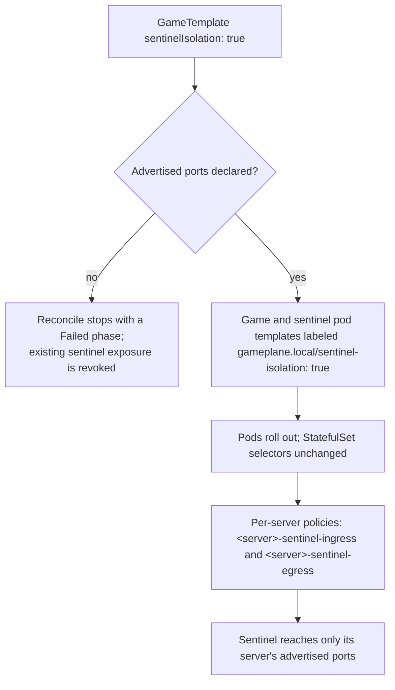
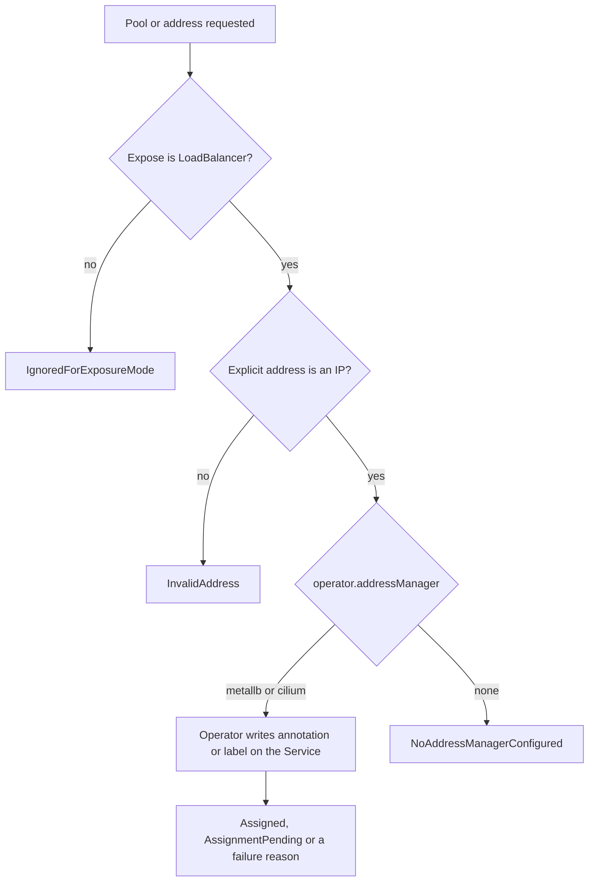

# Networking & Address Pools

Gameplane exposes game servers through Kubernetes Services, with optional integration with your cluster's load-balancer address manager to assign specific public addresses or address pools to each server.

## NetworkPolicy isolation and migration

NetworkPolicies are additive. An allowance in one policy cannot be narrowed by
another policy. Enforcement also requires a CNI that implements NetworkPolicy.

Modules may set `GameTemplate.spec.sentinelIsolation: true`. The operator then
labels the game and sentinel pod templates and creates two owned policies:
`<server>-sentinel-ingress` and `<server>-sentinel-egress`. They allow a sentinel
to reach only its own server's advertised container ports, with the declared
protocol. Zero advertised ports creates no allowance. Management ports must
remain `advertise: false`. The legacy chart policies exclude opted-in sources
and destinations. Templates without the field retain the existing broad
sentinel-to-game allowance; module maintainers can adopt it after validating
their proxy traffic.

For an opted-in template, the operator applies the isolation in this order:



Upgrade the CRDs, operator and chart together before opting in a template.
Existing game pods roll out to acquire the isolation label; StatefulSet
selectors stay unchanged. Do not claim isolation until both game and sentinel
pods have the label and the per-server policies exist. Other administrator-added
policies can still grant wider access. Disabling chart NetworkPolicies or using
a non-enforcing CNI does not provide this boundary.

Probe and API-server narrowing is a separate installation option:

```yaml
networkPolicies:
  enabled: true
  strict: true
  kubeletCIDRs: ["192.0.2.10/32"]       # Replace with observed kubelet sources.
  probePorts:
    - {protocol: TCP, port: 25565}    # Replace with all configured probe ports.
  apiServerCIDRs: ["198.51.100.20/32"] # Replace with actual API endpoints.
```

Strict mode rejects missing/empty lists, malformed CIDRs and invalid probe
ports. It never supplies broad fallback ranges. API egress is limited to the
listed addresses on TCP 443/6443. Choose addresses based on your CNI's policy
evaluation point: service DNAT or source SNAT can change which address it sees.
Include every control-plane endpoint and kubelet source that can host a server;
update these lists when nodes or endpoints change. CNI host-traffic exceptions
may still apply.

On Cilium, CIDR rules exclude node identities by default. For a self-hosted
API server on a node, configure `policyCIDRMatchMode=nodes` before using these
plain NetworkPolicy endpoint CIDRs, or provide equivalent Cilium-specific
API-server policy. The CI fixture uses nodes mode. See
[Cilium CIDR policy semantics](https://docs.cilium.io/en/stable/security/policy/layer3/#selecting-pods-or-nodes-with-cidr-ipblock)
and validate kubelet source handling for your Cilium configuration as well.

Before enabling strict mode, inventory the actual endpoints and configured
game probes, observe their traffic in the CNI, then validate game readiness,
agent heartbeats, wake requests and API/operator agent access in a staging
namespace. The default profile retains RFC1918/link-local API egress for
compatibility, and admits kubelet probes only to each server's probe ports
(`networkPolicies.probeIngress.enabled`, on by default). It does not isolate
those paths.
Narrowing sentinel traffic alone cannot remove those separate grants.

The dedicated CI `network-isolation` bucket installs pinned Cilium, exercises
real allowed/denied connections, and upgrades existing legacy templates.
The default kindnet fixture only verifies policy shape.

## Address Pool Overview

When a GameServer is exposed as a LoadBalancer (`spec.networking.expose: LoadBalancer`), it can request a specific external address or address pool. The operator translates this request to your cluster's load-balancer flavor so the same CRD works whether you run MetalLB, Cilium, or no address manager at all.

The address preference is optional—it only takes effect when expose mode is LoadBalancer, and it does not affect ClusterIP, NodePort, or Hostport servers.

### Flavors

Your cluster must have one of these configured via the Helm value `operator.addressManager` (see [`install.md`](install.md)):

**MetalLB**

MetalLB manages pools of available IPs. When you set `spec.networking.addressPool: my-pool` or `spec.networking.address: 203.0.113.50`, the operator writes:
- Annotation `metallb.io/address-pool: my-pool` (if requesting a pool)
- Annotation `metallb.io/loadBalancerIPs: 203.0.113.50` (if requesting a specific address)

MetalLB's controller observes these annotations and assigns an address accordingly. See [MetalLB's documentation](https://metallb.universe.tf/) for pool setup and address allocation policies.

**Cilium**

Cilium's LB IPAM manager also organizes addresses into pools. When you set a pool or address, the operator writes:
- Label `gameplane.local/lb-pool: my-pool` (if requesting a pool)
- Annotation `lbipam.cilium.io/ips: 203.0.113.50` (if requesting a specific address)

**Critical requirement**: The label `gameplane.local/lb-pool` is a Gameplane convention, not a key Cilium recognizes natively. For the pool preference to take effect, you **must** mirror it in your `CiliumLoadBalancerIPPool` resource's `spec.serviceSelector`, otherwise the pool label selects nothing and the address assignment uses the cluster's default pool.

Example `CiliumLoadBalancerIPPool` with a Gameplane pool selector:

```yaml
apiVersion: cilium.io/v2alpha1
kind: CiliumLoadBalancerIPPool
metadata:
  name: gameservers
spec:
  cidrs:
  - cidr: 203.0.113.0/24
  serviceSelector:
    matchLabels:
      gameplane.local/lb-pool: gameservers
```

This ensures that when a GameServer requests pool `gameservers`, the label routes the address assignment to this pool.

**None** (default)

When `operator.addressManager` is `none`, the operator does not mutate the Service at all. A pool or address preference is recorded on the GameServer's `AddressAssignment` condition as **unhonored** — this prevents the server from silently coming up on a default-pool address while looking assigned. The preference is visible in the condition for troubleshooting, but not applied to the Service.

## Setting an Address Pool or Specific Address

### Via CRD (kubectl)

Edit the GameServer and set one or both of `spec.networking.addressPool` and `spec.networking.address`:

```yaml
apiVersion: gameplane.local/v1alpha1
kind: GameServer
metadata:
  name: my-server
spec:
  templateRef:
    name: minecraft-java
  networking:
    expose: LoadBalancer
    addressPool: public-servers    # Optional: request a specific pool
    # address: 203.0.113.50        # Optional: request a specific address
```

The pool and address names come from your address manager's own configuration. For MetalLB, use the name of an `IPAddressPool` resource; for Cilium, use the name you gave to a CiliumLoadBalancerIPPool.

### Via Dashboard

1. Create or edit a server.
2. Set **Expose mode** to `LoadBalancer`.
3. Under **Networking**, fill in **Address pool** (pool name) and/or **Address** (specific IP).
4. Save.

The dashboard translates these to the CRD fields; the operator then applies them to the Service.

## Address Preference Behavior

The operator checks a requested pool or address in this order, and the first matching branch sets the `AddressAssignment` reason:



### When Expose Mode is LoadBalancer

- `addressPool` and `address` are honored by the address manager (MetalLB or Cilium).
- The operator records `status.conditions[type=AddressAssignment]` showing whether the assignment is `Assigned`, still `AssignmentPending`, or has failed (e.g., `ServiceNotReady`, `NoAddressManagerConfigured`).
- Once assigned, `status.endpoints` lists the address and pool name.

### When Expose Mode is Not LoadBalancer

- `addressPool` and `address` are ignored by the operator.
- `status.conditions[type=AddressAssignment]` reason becomes `IgnoredForExposureMode`, explaining that the preference only applies to LoadBalancer.
- This prevents confusion if the fields are set but not in use.

### When No Address Manager is Configured

- A preference is recorded on the `AddressAssignment` condition as `NoAddressManagerConfigured`.
- The Service gets no address-pool annotations or labels.
- The server comes up on whatever address the cluster's default policy assigns.

## Troubleshooting Address Assignment

### Reading the Condition

Check the server's AddressAssignment condition:

```bash
kubectl get gs my-server -o jsonpath='{.status.conditions[?(@.type=="AddressAssignment")]}'
```

This shows the current state and a human-readable message. Common reasons:

| Reason | Meaning | Action |
|--------|---------|--------|
| `Assigned` | Address successfully assigned from the requested pool. | No action needed; the server is reachable at the assigned address. |
| `AssignmentPending` | Address requested, but the load-balancer has not assigned one yet. | Wait; address assignment can take a few seconds. If this persists, check the load-balancer's own status. |
| `ServiceNotReady` | The LoadBalancer Service does not exist yet or is not typed LoadBalancer. | Verify expose mode is set to `LoadBalancer`. Check that the service object was created: `kubectl get svc my-server`. |
| `IgnoredForExposureMode` | Pool/address was set, but expose mode is not LoadBalancer. | Change expose mode to `LoadBalancer` to honor the preference, or remove the pool/address preference. |
| `InvalidAddress` | The requested `spec.networking.address` is not a parseable IP address. Rejected before it ever reaches the address manager; no annotation or label is written. | Correct `spec.networking.address` to a valid IP literal. |
| `NoAddressManagerConfigured` | Preference set, but the cluster has no address manager configured. | Contact your cluster admin to configure `operator.addressManager` in the Helm chart, or unset the preference. |
| `PoolNotFound` | The requested pool does not exist in the cluster. For Cilium, this is derived directly from the Service condition `cilium.io/IPAMRequestSatisfied=False` (reason `no_pool`). For MetalLB, this is a best-effort detection via direct IPAddressPool lookup, so it is not guaranteed to appear — a MetalLB that stays silent leaves the condition on `AssignmentPending` instead. | Check the pool name against the address manager's own resources (`kubectl get ipaddresspool -A` for MetalLB, `kubectl get ciliumloadbalancerippool` for Cilium), then correct `spec.networking.addressPool`. |
| `AllocationFailed` | The address manager could not allocate an address from the requested pool. For MetalLB, this covers exhausted pools, addresses outside the pool's range, and other allocation errors — the specific cause is in the condition message. For Cilium, this is derived from the Service condition `cilium.io/IPAMRequestSatisfied=False` (reason `out_of_ips`). | Free an address by deleting or re-pooling another Service, widen the pool's CIDR, or point the server at a different pool. Check the condition message for the specific cause. |
| `AddressInUse` | The requested explicit address is already taken. The operator detects this directly when another GameServer anywhere in the cluster already reports that address in its `status.endpoints` (named as `namespace/name` if the conflict is in a different namespace); it is also derived best-effort from address-manager Warning events when the clash is with a non-Gameplane Service or a host on the network. | Pick a free address, or release it on the server that holds it. The condition message names the conflicting GameServer when the operator found it itself. |

### Checking the Service Metadata

Verify the operator applied the annotations/labels:

```bash
# MetalLB
kubectl get svc my-server -o jsonpath='{.metadata.annotations}' | jq '.["metallb.io/address-pool"]'

# Cilium
kubectl get svc my-server -o jsonpath='{.metadata.labels}' | jq '.["gameplane.local/lb-pool"]'
```

If the expected key is missing, the operator may not have applied it. Check:
1. **Expose mode**: Must be `LoadBalancer`.
2. **Address manager flavor**: Verify `operator.addressManager` matches your setup (e.g., if you set `cilium`, the label should appear; if `none`, it should not).
3. **Operator logs**: `kubectl logs -n gameplane-system deployment/gameplane-operator` for errors during reconciliation.

### Address Manager Setup Issues (Cilium Only)

For Cilium, verify the load-balancer pool's serviceSelector matches the label the operator sets:

```bash
# Check the pool resource
kubectl get ciliumloadbalancerippool gameservers -o yaml | grep -A 5 serviceSelector

# Verify the GameServer service has the matching label
kubectl get svc my-server -L gameplane.local/lb-pool
```

If the label is on the Service but the address is not assigned, the pool's `spec.serviceSelector` may not include it, or there are no free addresses in the pool's CIDR.

### MetalLB Pool Issues

For MetalLB, check:

```bash
# Verify the pool exists
kubectl get ipaddresspool my-pool

# Check MetalLB's speaker log for assignment failures
kubectl logs -n metallb-system -l app=metallb -c speaker
```

Common causes: pool does not exist, pool has no free addresses, or an IP conflict exists on the network.

## Live Address Changes

When you change `spec.networking.addressPool` or `spec.networking.address` on a running server (one with connected players), the following happens:

1. The operator updates the Service's annotations (for MetalLB) or labels (for Cilium) on the next reconcile to reflect the new preference.
2. The load-balancer controller observes the updated Service metadata.
3. The load-balancer then re-evaluates the address assignment based on the new preference.

**What happens to the assigned address:**

The exact behavior depends on the load-balancer implementation and is not fully determined by the operator code alone:

- **MetalLB**: When the `metallb.io/address-pool` annotation changes, MetalLB's controller may either reassign an address from the new pool or leave the current address in place (if it belongs to the new pool). The specific behavior depends on MetalLB's allocation policy and your pool configuration. Reassignment, if it occurs, causes existing player connections using the old address to drop; new join attempts use the new address.
- **Cilium**: Similarly, when the `gameplane.local/lb-pool` label changes, Cilium's LB IPAM re-evaluates the pool selection and may reassign the address. The specific behavior is configuration-dependent.

For this reason, **changing the pool on a live server should be avoided when possible**. If you must change it, do so during low-traffic windows and notify players that a brief connectivity interruption may occur.

**Verification:**

The project's e2e test `TestAddressPool_ChangePoolOnRunningServer` verifies that the pool assignment metadata is updated on the GameServer's status; it does not verify whether the actual IP address remains stable or changes, as this is load-balancer dependent. To determine the exact behavior in your deployment, test the address-change scenario against your specific load-balancer version and pool configuration before relying on it in production.

## A Hostname as the Server's Address

Set `spec.networking.hostname` to the DNS name players use. The operator
adds it to the Service as an external-dns hint
(`external-dns.alpha.kubernetes.io/hostname`), and on a LoadBalancer server,
once the load balancer has published an address, `status.endpoints` and the
dashboard report the hostname in place of that address, with the Service's
ports. Players then see the name instead of an IP.

The operator doesn't create the DNS record. With external-dns watching
Services, the record is created from the hint and follows the load balancer
if it hands out a new IP. A record you keep yourself must be updated by hand
when that happens, or players reach the old address. A ClusterIP server
keeps reporting its cluster address.

The load balancer's address stays in `status.endpoints[].serviceAddress`, and
address-conflict checks for `spec.networking.address` compare against it, so
a server advertising a hostname still holds its IP.

This applies to every LoadBalancer server with a hostname, including ones
created before the upgrade that introduced it. A hostname that doesn't
resolve to its server would now be shown to players, so before upgrading,
check each such hostname, or clear it where it isn't the name players use.

### Connecting to a NodePort server

The dashboard's **External Address** shows and copies the game host and
the NodePort Kubernetes assigned, for example `play.example.net:31042`.
Set **Settings → Networking → Hostname** (`spec.networking.hostname`) to a
name that players can resolve and reach on that port. With no hostname,
Gameplane uses a Kubernetes `ExternalIP` on the node serving the game or
its wake proxy. IPv6 addresses appear in brackets, as in
`[2001:db8::42]:31042`.

If no external IP is available, set the game hostname to publish an
address. On a cluster behind a router, point that name at the router
and forward the advertised NodePort. If the router exposes a different
public port, players need that port from the router configuration.
The chart's `ingress.host` routes HTTP to the panel and can point to
a different machine.

## Choosing a Load-Balancer Implementation

A cluster can run more than one load-balancer implementation, each handling
Services of its own class: a cloud's, MetalLB, Tailscale's operator, or a
custom one for game traffic. Set `spec.networking.loadBalancerClass` on a
LoadBalancer server to pick one; it becomes the Service's
`spec.loadBalancerClass`. Unset, the operator doesn't manage the class: a new
Service has none, so the cluster's default implementation handles it, and an
existing Service keeps any class something else gave it.

Kubernetes doesn't allow changing a Service's class, or adding one to a
LoadBalancer Service that has none, so when the field is set or changes, the
operator deletes the Service and creates it again with the new class. The server keeps running, but its Service gets a new cluster IP and,
usually, a new external address, so players reconnect. Removing the field
leaves the Service's class as it is until the Service is next replaced. The
class is a Kubernetes qualified name, such as `example.com/games`: the part
after the slash is at most 63 characters. The dashboard doesn't edit the
class, and keeps it when you save other networking settings; set it through
the API or `kubectl`.

An address pool or address (`addressPool`, `address`) is a request to the
configured address manager; a Service of another class is outside that
manager's control, so leave them unset with a class of another
implementation.

## Port Pools

Some installs reach every game server through one public address, a relay
or an edge that forwards a range of ports to the cluster's load balancer.
Games whose clients send the hostname they connect to (Minecraft Java) can
share a port behind a router that picks the server by name, but most games
send no hostname, so behind one address each server needs ports of its own.
A port pool hands them out.

A pool is a range of ports on one shared endpoint. Name it for the endpoint,
and list the templates whose servers draw from it, with the Helm value
`operator.portPools`:

```yaml
operator:
  portPools:
    - name: edge
      ports: "2456-2499"
      templates: [valheim, factorio]
```

Every server of those templates then gets a contiguous block of the pool, one
port per advertised port, in template order: the first Valheim server
2456-2457, a Factorio server next 2458, the next Valheim server 2459-2460.
The pool decides who shares: a port goes to one server whatever its
template, and ports are reserved per protocol, so TCP 2456 and UDP 2456 are
two ports. A template draws from at most one pool.

The operator records each server's ports in its `gameplane.local/pool-ports`
annotation and keeps them for the server's life, so players' saved addresses
keep working. The Service publishes those ports and forwards them to the
game's own, and `status.endpoints` and the dashboard show them. Relays (frp,
Tailscale, Playit) forward to those ports too. The `PortAllocation`
condition lists them.

A server's explicit `spec.networking.portOverrides[].servicePort` is
reserved too, so the pool never hands it to another server. An override that
names a port another server already holds is refused: the server reports
`PortAllocation` `ServicePortConflict` and keeps the ports it had.

When no block is free, a new server reports `PoolExhausted` and gets no
Service or address until a block frees up, for example when a server is deleted. A
server that already has ports keeps them, and keeps working, sleeping and
waking, while a change it needs waits (`ChangePending`). A template update
that needs other ports reserves them before the server is restarted for it;
when the pool can't, the server stays on its current version and reports
`RolloutPending`. Servers that wait check again every 30 seconds, and their
games keep running.

Forward the whole range at the relay or edge, to the cluster's load
balancer. When you shrink a pool, existing servers keep their ports, even
ones outside the new range, and report `AllocatedOutsideRange` with those
ports. Keep forwarding them until you move those servers. New servers, and
servers that need new ports, for example for a template update, are given
ports from the smaller range. Removing a template from its pool returns its servers
to the template's ports. The full rules, including template revisions and
recovery, are in [spec 036](../specs/036-port-pools/spec.md).

## Related

- [`install.md`](install.md) — Helm chart values for `operator.addressManager` and cluster prerequisites.
- [`operator/api/v1alpha1/gameserver_types.go`](../operator/api/v1alpha1/gameserver_types.go) — CRD field definitions for `spec.networking.addressPool` and `spec.networking.address`.
